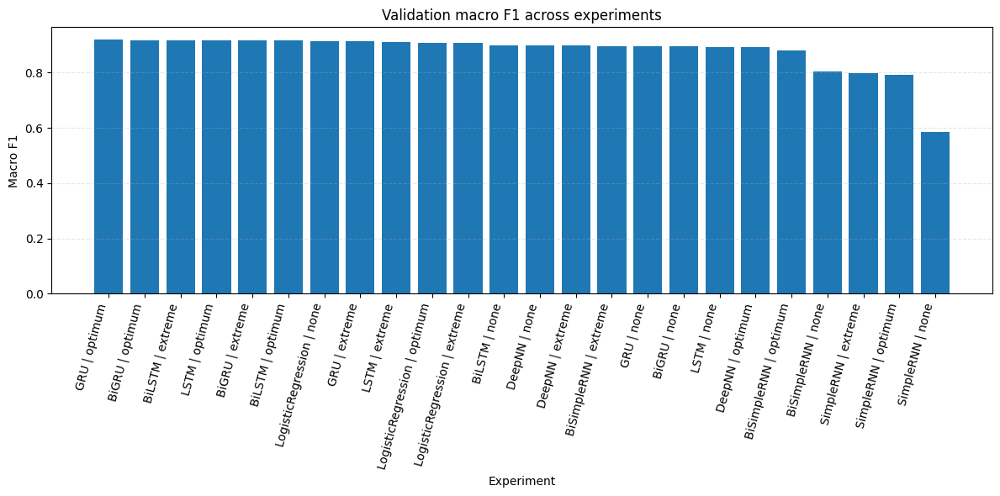

# News Topic Classification: Classical vs. Deep Learning

A systematic comparison of classical and deep learning models for classifying news articles into four topics: **Business**, **Science and Technology**, **Sports** and **World News**. Built for CSE440 (Natural Language Processing) at BRAC University.



## Results

The best model, a **GRU on frozen Skip-gram Word2Vec embeddings** with the "optimum" preprocessing, reached **92.01% accuracy and 0.920 macro-F1** on the held-out balanced test set (12,000 articles).

Best validation result for each model family:

| Representation | Model | Val. accuracy | Macro-F1 |
|---|---|---|---|
| TF-IDF | Logistic Regression | 0.9286 | 0.9150 |
| TF-IDF | DNN (4-layer, SVD-1024) | 0.9145 | 0.8990 |
| Skip-gram | **GRU** | 0.9310 | **0.9183** |
| Skip-gram | BiGRU | 0.9313 | 0.9179 |
| Skip-gram | LSTM | 0.9316 | 0.9177 |
| Skip-gram | BiLSTM | 0.9310 | 0.9177 |
| Skip-gram | BiSimpleRNN | 0.9123 | 0.8968 |
| Skip-gram | SimpleRNN | 0.8232 | 0.7968 |

Macro-F1 is the main metric because the training data is imbalanced (39.75% Sports, 12.15% World News) while the test set is balanced.

## What the project covers

- **Exploratory data analysis** of a noisy, HTML-wrapped corpus of 96,646 training articles: class imbalance, broken HTML entities (~33% of rows), backslash artifacts, length distributions and wire-service tags (Reuters, AP, AFP) that differ by class.
- **Three preprocessing levels** (none, extreme, optimum) to measure how much cleaning helps. Extreme preprocessing (stemming and stopword removal) lowered macro-F1 by 0.5–3.0 points compared with optimum.
- **Two text representations:** TF-IDF (with SVD compression for the DNN) and Skip-gram Word2Vec trained on the corpus.
- **Eight model architectures:** Logistic Regression, a 4-layer DNN, SimpleRNN, GRU, LSTM, and bidirectional versions of the three recurrent models.
- **A 144-run grid search** over dropout {0.3, 0.5}, batch size {32, 64} and epochs {5, 8} for the six sequence models across the three preprocessing levels. All runs are in [`results/hyperparameter_tuning_results.csv`](results/hyperparameter_tuning_results.csv).
- **A group-aware validation split:** duplicate texts are kept in the same partition, so validation scores are not inflated by leaked duplicates. The best validation macro-F1 (0.918) and test macro-F1 (0.920) match closely.

## Key findings

- TF-IDF Logistic Regression is a very strong baseline, only about 0.3 macro-F1 points behind the best deep model.
- Gated recurrent models (GRU, LSTM and their bidirectional versions) all land within 0.1 points of each other.
- SimpleRNN is unstable and sometimes collapses (macro-F1 below 0.10 with batch size 64), consistent with vanishing gradients over 60-token sequences.

## Run it

```bash
pip install -r requirements.txt
```

1. Put the course-provided `Training_data_13.csv` and `Test_data.csv` in a `data/` folder. The dataset is not included in this repository.
2. Open `news_topic_classification.ipynb` and run the cells in order. Intermediate results are cached in `project_cache/`, so long runs can resume.

If GitHub fails to display the notebook because of its size, open it in [nbviewer](https://nbviewer.org/) or download it.

## Tech stack

Python, TensorFlow/Keras, scikit-learn, Gensim (Word2Vec), NLTK, pandas, NumPy, Matplotlib, BeautifulSoup

## Authors

- Mohammed Mashrekin Yakub
- MD. Mashfiq Uz Zaman
